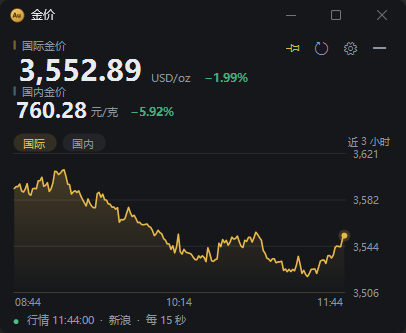
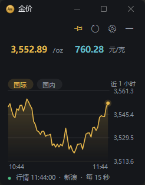
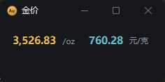
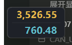

# 金价小工具（Windows 桌面 · C# WinForms）

一个常驻桌面的迷你行情窗口：国际金价（伦敦金，USD/oz）+ 国内金价（上期所黄金连续，元/克），
带 24 小时走势图，支持置顶、托盘隐藏、全局快捷键，窗口缩到最小时只显示当前价。



<table>
<tr>
<td></td>
<td></td>
</tr>
<tr><td align="center">窄而高：单行价格 + 走势</td><td align="center">最小：只有当前价</td></tr>
</table>

---

## 1. 环境要求

| 项目 | 要求 |
| --- | --- |
| 系统 | Windows 10 1809+ / Windows 11（托盘、全局热键、深色标题栏依赖系统 API） |
| 运行时 | .NET 9 桌面运行时（`Microsoft.WindowsDesktop.App 9.x`），或安装 .NET 9 SDK 自行编译 |
| 依赖 | 无第三方 NuGet 包，全部使用系统自带的 WinForms / System.Drawing |

## 2. 运行

三种方式任选：

```powershell
# ① 直接构建并启动（有 SDK 即可）
dotnet run --project GoldTicker\GoldTicker.csproj -c Release

# ② 双击 run.bat（首次会自动 build，之后直接启动 exe）

# ③ 打包成单文件 exe 分发
publish.bat
# 产物：publish\GoldTicker.exe（依赖 .NET 9 桌面运行时，体积约 1 MB）
```

启动后窗口出现在主屏右上角，默认 420×340、总在最前。

## 3. 操作

| 操作 | 方式 |
| --- | --- |
| 置顶 / 取消置顶 | 标题栏右侧图钉按钮，或托盘菜单「窗口置顶」 |
| 隐藏 / 显示 | 托盘图标单击；全局快捷键 `Ctrl+Alt+G`（可改）；最小化也会收进托盘；再次双击 exe 会把隐藏的窗口叫回前台 |
| 贴边收起 | 把窗口拖到屏幕左/右边缘松手，自动收成悬浮小窗（见第 5 节） |
| 展开 | 悬浮小窗单击或悬停（临时展开，失焦自动收回），或托盘菜单「展开完整窗口」 |
| 立即刷新 | 标题栏的刷新按钮，或托盘菜单「立即刷新」 |
| 设置 | 标题栏齿轮按钮，或托盘菜单「设置…」 |
| 切换走势品种 | 图表左上角的「国际 / 国内」标签 |
| 查看具体点位 | 鼠标悬停走势图，出现十字线和时间/价格气泡 |
| 退出 | 托盘菜单「退出」（配置和走势缓存会一起保存） |

界面右上角按钮从左到右：图钉（置顶，亮金色表示已置顶）、刷新、设置、最小化到托盘。

## 4. 贴边悬浮小窗



把窗口拖到屏幕**左边缘或右边缘**（16px 内）松手，会自动吸边并收成一个悬浮小卡：
上面一行国际金价、下面一行国内金价，**只显示数字**（金色 / 青色区分），不带文字和涨跌幅；背景半透明卡片 + 圆角 + 阴影，宽度按数字长度自适应。

| 操作 | 结果 |
| --- | --- |
| 单击卡片 | 临时展开完整窗口：3 秒宽限期过后，鼠标离开窗口或窗口失去前台焦点，就自动收回小窗（回到原来的贴边位置） |
| 悬停卡片 ~0.7s | 和单击一样临时展开完整窗口，3 秒后失焦自动收回（可在设置里关掉） |
| 拖动卡片 | 拖到边缘继续吸边；拖到屏幕中间则展开成完整窗口 |
| 托盘菜单 | 「收起为悬浮小窗 / 展开完整窗口」 |
| 再次双击 exe | 悬浮状态下会直接展开完整窗口 |

刚收起的 1.2 秒内不会响应悬停展开（此时鼠标通常还停在边缘），移开再回来才生效；这也避免自动收回小窗后立刻又被悬停弹开。
临时展开期间打开设置、点「隐藏窗口」或拖到屏幕边缘，会立刻结束临时状态，不会和 3 秒倒计时打架。

## 5. 窗口尺寸自适应

窗口高度决定信息层级，绘图区面积决定走势图的时间跨度：

| 客户区高度 | 显示内容 |
| --- | --- |
| < 120px（约窗口高 100–160px） | 只显示国际 / 国内当前价，无图表、无状态栏 |
| ≥ 120px 且图表区 < 70px | 两行价格 + 状态栏，无图表 |
| 图表区 ≥ 70px | 价格 + 状态栏 + 走势图 |

时间跨度按绘图区面积取一档：1 → 3 → 6 → 12 → 24 小时。
若历史数据只覆盖窗口的一小部分（例如国际金价接口只提供当日分时），
横轴会自动缩到真实覆盖范围，标签也同步显示「近 4.5 小时」这类真实跨度，不会假装画满 24 小时。
休市造成的断点会断开折线，不会连出一条假的直线。

窗口宽度 < 300px 时，两行价格自动降级为单行，避免数字被裁切。

## 6. 数据源

| 品种 | 主数据源 | 备用 |
| --- | --- | --- |
| 国际金价 | 新浪财经 `hf_XAU`（伦敦金现货，USD/oz） | 腾讯财经 `hf_XAU` → gold-api.com |
| 国内金价 | 新浪财经 `nf_AU0`（上期所黄金连续，元/克） | 新浪 `gds_AUTD`（黄金 T+D，同为元/克） |
| 走势历史 | 新浪分钟线：`GlobalFuturesService.getGlobalFuturesMinLine`（当日分时）<br>`InnerFuturesNewService.getFewMinLine`（国内近两日 1 分钟） | 本地累积采样（落盘，重启不丢，最多 30 小时） |

- 每次刷新按「主源 → 备用源」依次尝试，任一成功即用；界面上会标注实际生效的来源（新浪 / 腾讯 / GoldAPI / 新浪·T+D）。
- 请求客户端超时 7 秒，超时即降级，不会卡住界面。
- 全部失败时：保留上一次成功的数据并继续显示，状态栏变琥珀色，显示错误原因和「N 秒后重试」。
- 失败重试采用指数退避：15s → 30s → 60s → 120s → 180s 封顶，网络恢复后自动回到正常频率。
- 走势图每 3 分钟补拉一次历史，并与本地采样按分钟合并去重。

## 7. 配置

配置文件：`%APPDATA%\GoldTicker\config.json`
（若该目录不可写，依次回落到 `%LOCALAPPDATA%\GoldTicker`、程序目录下的 `GoldTickerData`）

| 字段 | 说明 |
| --- | --- |
| `RefreshSeconds` | 刷新间隔，3–600 秒，默认 15 |
| `SourcePreference` | `auto` / `sina` / `tencent` / `goldapi` |
| `IntlSymbol` / `DomSymbol` | 新浪代码，默认 `hf_XAU` / `nf_AU0` |
| `Hotkey` | 全局快捷键，需含修饰键，如 `Ctrl+Alt+G`、`Ctrl+Shift+F9` |
| `TopMost` | 是否总在最前 |
| `StartHidden` | 启动时直接收进托盘 |
| `ChartSeries` | 走势图默认品种 `intl` / `dom` |
| `EdgeAutoHide` | 拖到边缘自动收起为悬浮小窗，默认 `true` |
| `MiniHoverExpand` | 悬停悬浮小窗时展开，默认 `true` |
| `EdgeSnapDistance` | 判定「靠边」的像素距离，默认 16 |
| `WinX/WinY/WinW/WinH` | 上次窗口位置与尺寸（关窗时保存） |

设置窗口改完点「保存」即刻生效：换数据源会清空旧报价并立刻重拉，改快捷键会重新注册（若被占用会弹提示）。

## 8. 自检与日志

```powershell
# 不走界面，直接抓一轮行情 + 历史，结果写到程序目录的 selftest.txt
GoldTicker.exe --selftest
```

自检输出示例：

```
intl   OK  price=3525.04 unit=USD/oz src=新浪 time=2026-11-20 11:27:00 pct=+0.42%
dom    OK  price=760.60 unit=元/克 src=新浪 time=2026-11-20 11:27:21 pct=-0.31%
hist-i 268 pts  2026-11-20 07:00 → 2026-11-20 11:26
hist-d 1023 pts 2026-11-18 14:56 → 2026-11-20 11:28
```

运行日志：配置目录下的 `app.log`（超过 256 KB 自动重建），记录每次报价成功/失败、历史抓取、快捷键注册结果。

## 9. 资源占用

- 单进程、无子进程、无本地服务；常驻显示走势图时约 0.9% 单核 CPU、80 MB 工作集（.NET 桌面运行时基线）。
- 隐藏到托盘后不再重绘，只有定时网络请求（默认 15 秒一次，两个接口）。
- 无外部依赖、无自动更新、无遥测。

## 10. 项目结构

```
GoldTicker/
├─ GoldTicker.csproj   # net9.0-windows + WinForms，无 NuGet 依赖
├─ Program.cs          # 入口、单实例互斥、--selftest 自检
├─ MainForm.cs         # 主窗口：自绘界面、走势图、托盘、全局热键、自适应布局、贴边收起
├─ MiniForm.cs         # 贴边后的悬浮小窗（两行价格，可拖动/悬停展开）
├─ SettingsForm.cs     # 设置对话框
├─ Providers.cs        # 行情/历史抓取与解析、超时与降级
├─ Models.cs           # 数据模型、配置读写、走势缓存、日志
└─ Theme.cs            # 配色、圆角、图标生成、深色标题栏、快捷键解析
```

## 11. 已知限制

- 国际金价的分钟线接口只返回**当日**分时（07:00 起），所以首日 24 小时视图只能显示当天已有的部分；
  连续运行后本地采样会补齐，重启也不丢（缓存 30 小时）。国内金价接口可直接给近两日 1 分钟数据。
- 托盘图标使用系统 NotifyIcon，多显示器 + 隐藏图标区时需从托盘溢出菜单里找。
- 界面为纯 WinForms 自绘，深色标题栏依赖 DWM 属性（Win10 1809 以下会退回系统默认配色，其余功能不受影响）。
- 数据来自新浪/腾讯/gold-api 的公开接口，非交易级行情，仅供参考。
